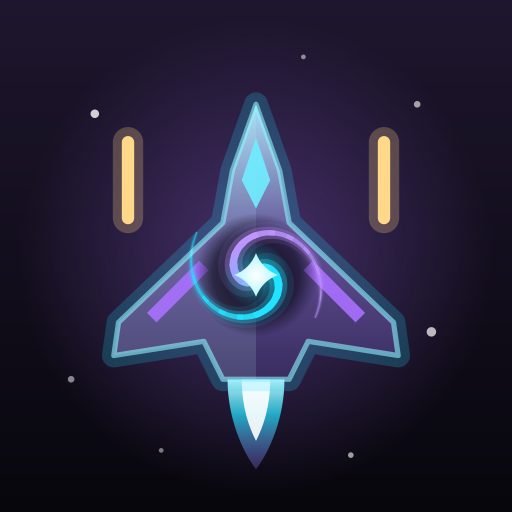

# Void Wars



A 3D top-down space shooter for Android (13+), from the VOID family: build a ship, paint it, and fly it
through a bullet hell. It's written in Kotlin and Jetpack Compose, with a hand-written OpenGL ES 2 renderer.
There are no third-party libraries, no ads and no accounts. The game goes online only to check for its own updates.

It plays in landscape. Every ship, rock and boss is a lit 3D mesh built in code, with no textures or bitmaps,
and every icon is a neon line drawing.

## Fly
- **Steering:** drag anywhere and the ship moves with your finger, so your thumb never covers it.
- **Guns:** they fire by themselves.
- **Hitbox:** only the tiny glowing core can be hit. Show or hide it in Settings.
- **Grazing:** bullets that brush past you count as grazes. Grazes and kills charge your **special**.
- **Chains:** kills build a chain that multiplies your score. Taking a hit breaks it.
- **Drops:** wrecks drop credits, repairs and power-ups.
- **Revive:** shot down? Spend a core to revive, once per run.

## Campaign
There are five sectors with six stages each:
- **Outer Rim**
- **Crimson Belt**
- **Ion Storm**
- **Dead Fleet**
- **Void Heart**

Each sector has its own sky, enemies and music track. Stages 3 and 5 bring a carrier, and stage 6 is a boss:
- **The Warden**
- **Hydra**
- **Tempest**
- **Revenant**
- **the Void Heart**

Each stage can earn up to three stars:
- one for clearing it,
- two for finishing with 60% hull,
- three for also shooting down 80% of what came.

A new sector opens once the previous boss is down and you've reached the sector's pilot level.

Beat the Warden to open **the Rift**, an endless mode that gets faster and harder, with a boss every few minutes.

## The hangar
Six slots, each with parts to buy, fit and upgrade (up to Mk 5):
- **Hull** (8): Dart, Wasp, Manta, Talon, Bulwark, Phantom, Halo, Wraith. Hulls trade armour, speed and hitbox size.
- **Wings** (7): bonuses to damage, speed, graze range, fire rate, magnet or special charge.
- **Engine** (4): Ion, Afterburner, Fusion (self-repair) and Quantum (longer invulnerability).
- **Weapon** (7): Pulse, Scatter, Lance beam, Seekers, Plasma, Rail and Flak. Upgrades add streams, damage and size.
- **Support** (5): wing drones, a missile pod, orbital shields or a Tesla coil.
- **Special** (5):
  - Nova bomb
  - Overdrive
  - Phase shift
  - Singularity
  - Barrage

**Paint**
- Three channels: body, trim and glow.
- 24 colours.
- Six finishes: matte, gloss, metallic, chrome, holo, and Void (starlight under the paint).
- Seven patterns.

Anything can be tried on before you buy it, and the stats panel shows what would change.

## Progress
- **Credits** come from flying.
- **Cores**, which are rarer, come from bosses, three-star clears, missions, medals and the daily supply drop.
- **Pilot levels** unlock parts and sectors, and pay a bonus on every level-up.
- **Daily missions:** three new ones every day, with a bonus when all three are done.
- **Medals:** 28 of them, each paying cores.
- **Daily supply drop:** the reward grows with your streak.

## Light on the phone
Battery saver, Balanced and Beautiful change four things:
- render scale
- multisampling
- particle budget
- nebula detail

A 60 fps cap is on by default.

Memory use stays low:
- Bullets, shots and particles live in fixed, preallocated pools of plain arrays, so play allocates almost nothing.
- Everything on screen that isn't a ship is drawn in one sprite batch.
- Meshes are built once and cached.
- The menus sit on top of the same GL view, which plays a demo battle behind them.

## Feel
Every sound and all the music are synthesized in code: blasters, explosions and a synth track for each sector, the
bosses and the Rift. Hits, explosions and taps have matching haptics. The seven VOID themes are included, and the app
icon can follow the theme.

## Updates
Settings › Updates shows the version and checks this repository's GitHub releases. It also checks by itself and sends a
notification when there's something new. Each download is checked against the published SHA-256 before Android's
installer takes it.

## Build
```
./build.sh testDebugUnitTest assembleRelease   # → VoidWars.apk
```
Needs `../void-ui` next to it. The unit tests do four things:
- fly every stage headless, to the end, with a ship too tough to lose
- run every weapon and special
- check the Rift's bosses
- build every mesh

`./release.sh "What changed"` bumps the version and publishes. `art/gen_icon.py` regenerates the launcher icons for
every theme.
